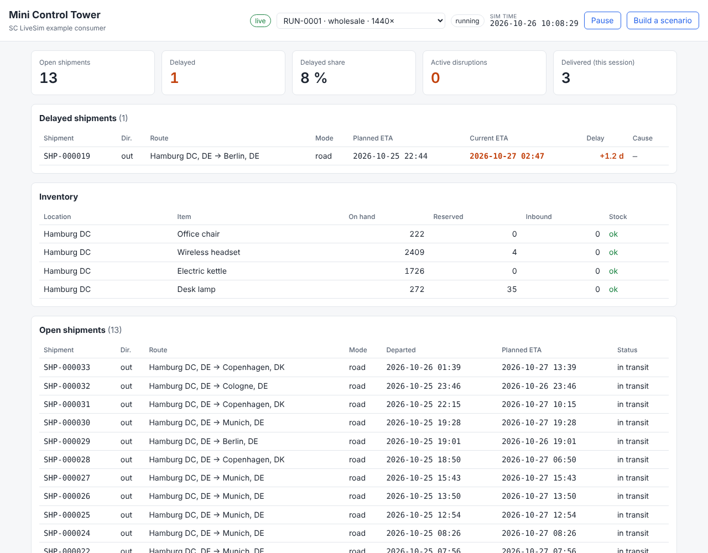
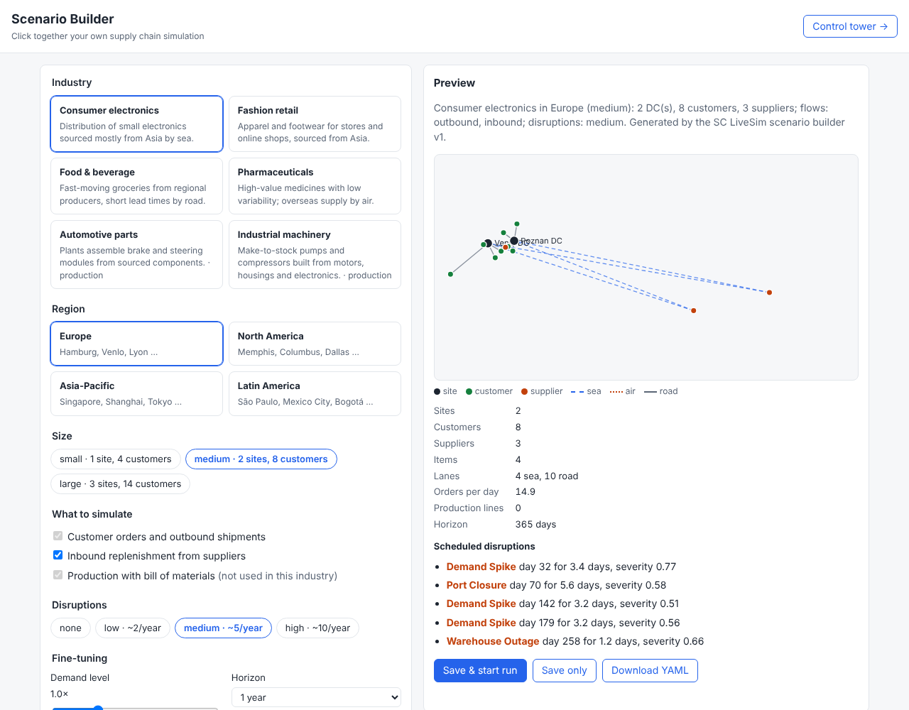

# Mini Control Tower and Scenario Builder

Two static pages with plain JavaScript, no build step, no framework:

- `index.html`, the **mini control tower**: a minimal consumer that shows open and
  delayed shipments, inventory and active disruptions of a run live.
- `builder.html`, the **scenario builder**: click together a scenario (industry,
  region, size, flows, disruptions), preview its network, save it and start a run;
  or continue the DataCo dataset with a calibrated simulation.





## Run it

With Docker Compose they run at <http://localhost:8080> and
<http://localhost:8080/builder.html>. Without Docker, serve
the folder with any static web server while the API runs on port 8000:

```bash
python -m http.server 8080 --directory examples/control-tower
```

Point it at another API with `?api=http://host:port`.

## How it works

1. `GET /runs` fills the run picker (default: the most recent active run, or `?run=`).
2. It subscribes to `GET /stream?run=…&types=shipment.departed,shipment.delayed,…`
   (Server-Sent Events) **before** loading data, so no event is missed.
3. `GET /shipments?open=true&expand=order` loads the current open shipments.
4. Each event updates an in-memory map:
   - `shipment.departed` adds a shipment,
   - `shipment.delayed` marks it delayed and sets the new ETA,
   - `shipment.delivered` removes it.
5. Inventory and disruptions are refreshed every 3 seconds (`GET /inventory`,
   `GET /disruptions`); low stock is learned from `inventory.below_safety_stock` events.
6. The pause/resume button calls `POST /runs/{id}/pause|resume`.

Everything goes through the access layer; the page never talks to the database.
That is the pattern any consumer (risk tool, notebook, dashboard) can follow.
